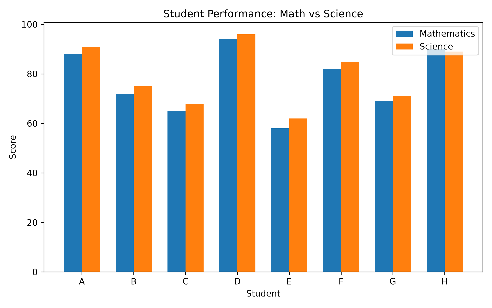

# Student Performance Data Analysis

## Project Overview

This beginner-level data analysis project explores student attendance and academic scores using Python. It uses a fictional sample dataset to practice data analysis, data quality checks, and visualization.

## Objectives

- Load and inspect student data from a CSV file.
- Calculate average attendance and subject scores.
- Compare Mathematics and Science performance.
- Identify the student with the highest average score.
- Validate data quality.
- Visualize subject scores using a bar chart.

## Tools and Technologies

- Python
- Pandas
- Matplotlib
- CSV
- Visual Studio Code
- Git and GitHub

## Dataset

The file `student.csv` contains 8 fictional student records with these columns:

- `Student`
- `Attendance`
- `Math_Score`
- `Science_Score`

## Data Quality Checks

The program was run successfully with the following results:

- Missing values: 0
- Duplicate rows: 0
- Attendance values outside the 0–100 range: 0 invalid records
- Mathematics scores outside the 0–100 range: 0 invalid records
- Science scores outside the 0–100 range: 0 invalid records

## Key Findings

Based on the fictional sample dataset:

- Average Mathematics score: **77.25**
- Average Science score: **79.625**
- Average attendance: **83.25**
- Highest average score: **Student D**, with **95.0**

These findings describe only the fictional sample data and should not be generalized to real students.

## Visualization

The following chart compares Mathematics and Science scores for each student.



The chart is generated by `main.py` and saved as `student_performance.png`.

## How to Run

1. Install Python.
2. Install the required libraries:

   ```bash
   python -m pip install pandas matplotlib
   ```

3. Keep `main.py` and `student.csv` in the same project folder.
4. Run the program:

   ```bash
   python main.py
   ```

The program prints summary statistics, student average scores, data quality results, and the highest-performing student. It also generates the comparison chart.

## Project Status

The analysis script has run successfully, the data quality checks have passed for the current fictional dataset, and the project files have been uploaded to GitHub.

## Learning Outcomes

This project provided practice with CSV data loading, Pandas calculations, data quality validation, Matplotlib visualization, and Git/GitHub version control.

## Run the Interactive Dashboard

### 1. Install the required libraries

```bash
python -m pip install pandas matplotlib streamlit
```

### 2. Start the dashboard

```bash
python -m streamlit run dashboard.py
```

### 3. Open the dashboard

Streamlit will display a local URL in the terminal, usually:

http://localhost:8501

Open that URL in your browser.

## Dashboard Features

- Student performance summary metrics
- Data quality checks
- Mathematics and Science comparison chart
- Performance category distribution
- Filterable student records
- Downloadable CSV analysis report
